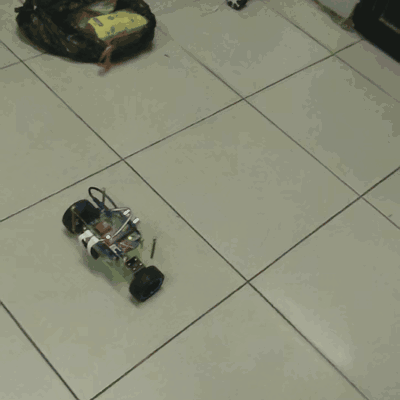
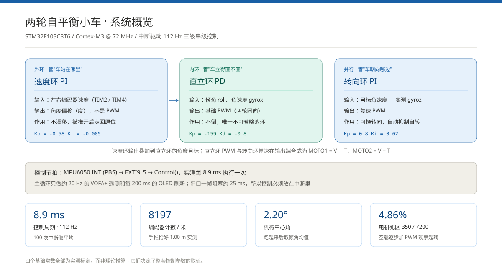
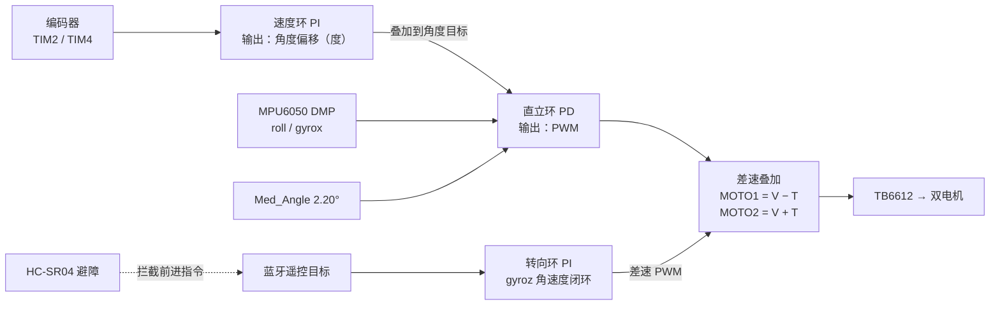

# 两轮自平衡小车 · STM32F103C8T6


一台能在一定范围内自己保持直立、被推开后自己走回原位、可用手机蓝牙遥控、前方 30 cm 有障碍会拒绝前进的两轮自平衡小车。

**这个项目的重点不是"做出来了"，而是"测准了、并且用数据推翻过自己的判断"**：控制周期、编码器刻度、机械中心角、电机死区四个基础常数全部实测标定；三个稳定性问题的定位过程都有量化数据和前后对比；控制核心 `Core/Src/pid.c` 里保留了完整的机理注释，包括一个失败实验的结论。

## 实物演示



[观看完整运行视频（37 秒 · MP4）](assets/demo.mp4) · [演示素材说明](assets/README.md)

> 动图取自实拍视频前 20 秒，方形裁切后循环播放；完整视频为 720×1280 竖屏原片转成 H.264，在 GitHub 页面点击即可播放。



---

## 30 秒看懂

| | |
|---|---|
| 主控 | STM32F103C8T6，Cortex-M3 @ 72 MHz |
| 姿态 | MPU6050 DMP 输出四元数 → 倾角，INT 引脚驱动控制节拍 |
| 驱动 | TB6612 + 两个带编码器的 25GA370 减速电机 |
| 控制 | 直立环 PD（内环）+ 速度环 PI（外环）+ 转向环 PI（偏航角速度闭环） |
| 节拍 | **实测 8.9 ms / 约 112 Hz**，跑在 EXTI 中断里，与主循环完全解耦 |
| 交互 | 蓝牙遥控 + 超声波避障 + OLED 本地显示 + VOFA+ 实时遥测 |
| 工具链 | CMake + Ninja + arm-none-eabi-gcc，可从命令行一键编译 |

**四个最值得看的点**

1. **控制周期是测出来的，不是写死的 10 ms**。用 `HAL_GetTick()` 对 100 次中断取平均，实测 8.9 ms；写死 0.01 s 会带来 12% 的系统偏差。
2. **编码器输入滤波未开启，白吃掉 30% 的直立环增益**。开启 `IC1Filter/IC2Filter = 15` 后可用增益从 −122 提升到 −159；这个发现推翻了原先"相位裕度已到极限"的判断。
3. **速度环 P 项与 I 项必须分别限幅**。原来对两者之和做一次限幅，积分项攒满会挤占 P 项（刹车能力），导致"轻推回不来"。
4. **转向环从开环改为偏航角速度 PI 闭环**，转向速度不再随电池电压和地面摩擦漂移，且目标值为 0 时自动变成自转阻尼。

---

## 实测常数

这些数字是整套控制参数的地基，全部来自实测而非理论推算：

| 常数 | 实测值 | 测法 |
|---|---|---|
| 控制周期 | **8.9 ms（112 Hz）** | `HAL_GetTick()` 对 100 次中断取平均，并实时上报上位机 |
| 编码器刻度 | **8197 计数 / 米** | 手推恰好 1.00 m，读不受限幅的累加器副本 |
| 机械中心角 | **2.20°** | 跑起来后取倾角平均值 |
| 电机突破 PWM | **约 350 / 7200 = 4.86%** | 空载逐步加 PWM，观察起转点 |
| 放大后的位置盲区 | **约 2.4 cm** | 由死区经 `Kp`、`Ki × 8197` 逐级折算 |

> 为什么 8197 不能靠算：推算值是 8790，而编码器线数若不是标称的 11 PPR，推算值会差 1.5~2 倍，足以把"刚好稳定"变成"发散"。详细推导见 [技术深潜](docs/技术深潜.md)。

---

## 控制架构



| 环 | 类型 | 输入 | 输出 | 负责 |
|---|---|---|---|---|
| 直立环 | PD | 倾角 roll、角速度 gyrox | PWM | 不倒（唯一不可省） |
| 速度环 | PI | 左右编码器速度 | **角度偏移**（不是 PWM） | 不漂走，被推后走回原位 |
| 转向环 | PI | 目标角速度 − gyroz | 差速 PWM | 遥控转向、抑制自转 |

速度环不直接驱动电机，而是**修改直立环的目标角度**：车被推走 → 角度目标变大 → 车体被要求前倾 → 前倾产生向前的加速度 → 恰好抵消刚才的位移。这是双轮倒立摆"一个驱动自由度、两个被控量"的必然结果。

**节拍与并发**：MPU6050 的 DMP 每算好一组姿态就拉低 PB5，触发 `EXTI9_5_IRQHandler` → `Control()`，完整跑完采样、三个环和输出。主循环只做两件不紧急的事：约 20 Hz 发一帧遥测、每 200 ms 刷新 OLED。串口发一个 24 字节帧在 9600 波特下会阻塞约 25 ms，比一个控制周期还长——所以控制逻辑必须放在中断里，否则频率会被串口拖到不可预测。

---

## 快速开始

### 环境

- CMake ≥ 3.22
- Ninja
- GNU Arm Embedded Toolchain（`arm-none-eabi-gcc` 在 PATH 中）
- 可选：CLion（直接打开 `CMakePresets.json`）、STM32CubeMX（打开 `balanceCar.ioc` 重新生成外设初始化）

### 编译

```bash
cmake --preset Debug
cmake --build --preset Debug
```

产物在 `build/Debug/balanceCar.elf`。生成可烧录文件：

```bash
arm-none-eabi-objcopy -O ihex  build/Debug/balanceCar.elf build/Debug/balanceCar.hex
arm-none-eabi-objcopy -O binary build/Debug/balanceCar.elf build/Debug/balanceCar.bin
```

Release 把两条命令里的 `Debug` 换成 `Release` 即可。完整的烧录方式、上电自检和常见坑见 [构建与烧录](docs/构建与烧录.md)，引脚与 BOM 见 [硬件与接线](docs/硬件与接线.md)。

> 工具链里已显式加了 `-u _printf_float`。GCC + newlib-nano 默认不支持 `printf` 浮点，少了它会让 OLED 和遥测里的 `%.2f` **静默输出空字符串**，编译完全不报错——这是从 Keil/ARMCC 迁移过来最容易踩的坑之一。

---

## 代码地图

访客（或面试官）不用读 729 个 HAL 库文件，真正需要看的是这几个：

| 路径 | 内容 |
|---|---|
| [`Core/Src/pid.c`](Core/Src/pid.c) | **核心**：三个控制环 + `Control()`。注释包含机理推导、实测方法和失败实验的结论，可直接逐行讲解 |
| [`Core/Src/motor.c`](Core/Src/motor.c) | PWM 输出、电机死区的 `tanh` 连续补偿、摔倒保护 |
| [`Core/Src/encoder.c`](Core/Src/encoder.c) | 左右轮编码器读数 |
| [`Core/Src/tim.c`](Core/Src/tim.c) | 定时器配置；编码器 `IC1Filter/IC2Filter = 15` 就在这里（关键修复） |
| [`Core/Src/sr04.c`](Core/Src/sr04.c) | 超声波测距与"无回波静默失效"检测 |
| [`Core/Src/stm32f1xx_it.c`](Core/Src/stm32f1xx_it.c) | EXTI9_5 → `Control()`；USART3 蓝牙指令解析 |
| [`Core/Src/main.c`](Core/Src/main.c) | 初始化、主循环的 VOFA+ 遥测与 OLED 刷新 |
| [`Core/Src/oled.c`](Core/Src/oled.c) | SSD1306 显示驱动 |
| `MyCode/` | MPU6050 / DMP 驱动（第三方，见许可说明） |
| `Core/Inc/`、`gpio.c`、`usart.c` 等 | STM32CubeMX 生成的外设初始化 |
| `Drivers/` | ST HAL / CMSIS 官方库（第三方，未做修改） |

---

## 深入理解

[docs/技术深潜.md](docs/技术深潜.md) 是这份 README 的深度补充，包含完整的排查过程、公式推导、面试问答和自测清单：

- **编码器滤波案例**：一个毛刺如何折算成 0.55° 目标角偏移、67 的 PWM 抖动，以及"先堵上游噪声，再谈调参"的方法论
- **限幅结构案例**：为什么线性区等于 `限幅值 / (|Ki| × 8197)` 米，以及阻尼/刚度比塌陷的实测表
- **一次失败的实验**：外环低通时间常数从 25 ms 提到 84 ms 后车反而自激振荡，以及为什么外环必须"快"
- **20 道模拟追问**：从"平衡车为什么不会倒"到"GCC 浮点打印为什么输出为空"

---

## 来源与边界

**这份材料刻意保持诚实**：直立环、速度环的基础框架、硬件驱动和 MPU6050 库来自开源参考实现。本人的工作是在这块具体硬件上完成移植与实测标定、诊断并修复三个有数据支撑的稳定性问题、重新设计速度环限幅结构与转向环、补齐超声波避障与遥测链路，以及完整的实测记录。

**已知局限**（也是下一步的方向）：

1. 电机死区与环路增益裕度存在物理冲突，要继续压小死区必须改硬件（低齿槽转矩电机 / 电流环驱动 / 磁编码器），现有参数下没有可用的中间窗口。
2. 蓝牙协议没有链路保护，手机 App 按住按键不重复发送，所以无法用"掉线超时"判停车；正确修法是接 STATE 引脚，但模块未引出。
3. 只做到速度控制，没有位置/路径规划。
4. 电池直供，电压下降仍会影响 PWM 到力矩的转换。

---

## 目录结构

```
balanceCar/
├── README.md                 本项目门面
├── LICENSE / THIRD_PARTY_NOTICES.md
├── CMakeLists.txt           顶层构建（用户源文件在这里登记）
├── CMakePresets.json        Debug / Release 预设
├── balanceCar.ioc           STM32CubeMX 工程
├── STM32F103C8Tx_FLASH.ld   链接脚本
├── cmake/                   工具链 + CubeMX 生成源文件清单
├── Core/
│   ├── Inc/                 头文件
│   └── Src/                 用户代码（pid / motor / encoder / sr04 / oled）+ CubeMX 生成代码
├── MyCode/                  MPU6050 + DMP 驱动（第三方）
├── Drivers/                 ST HAL / CMSIS（第三方）
├── docs/                    技术深潜、构建烧录、硬件接线
└── assets/                  架构图与演示素材（清单见 assets/README.md）
```

---

## 许可

本项目原创代码与文档采用 [MIT](LICENSE)。`Drivers/` 下的 ST HAL/CMSIS 与 `MyCode/` 下的 MPU6050/DMP 驱动为第三方代码，各自遵循原许可，详见 [THIRD_PARTY_NOTICES.md](THIRD_PARTY_NOTICES.md)。
